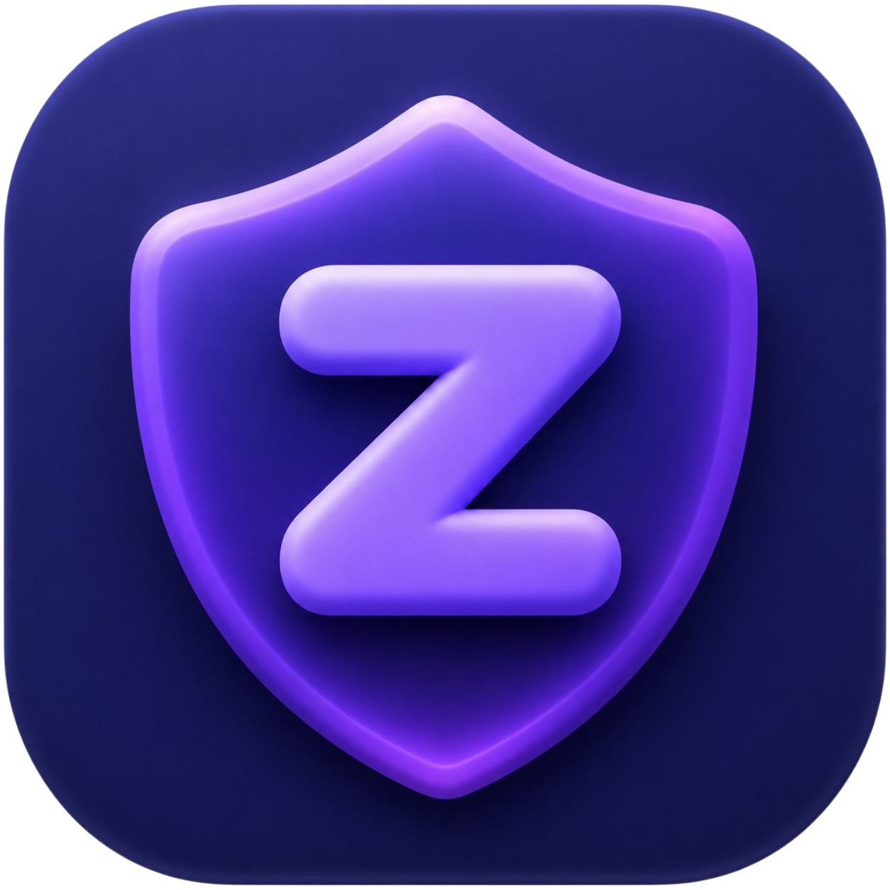
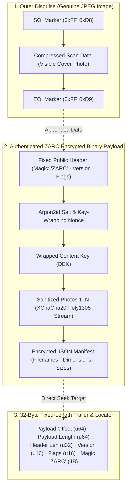
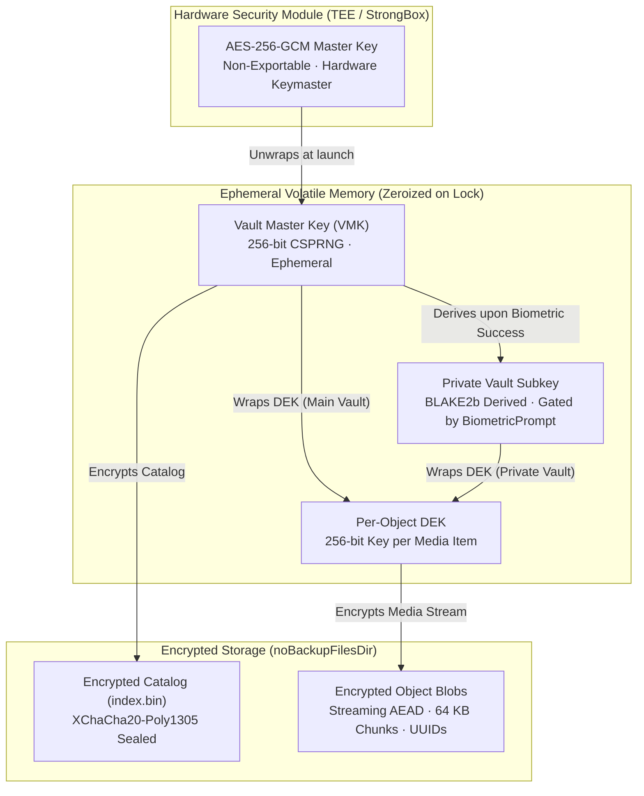

<div align="center">



# ZARC
### Zero-Knowledge Hardware-Backed Encrypted Vault & Disguised Polyglot Container Engine for Android

**An uncompromising, high-security offline media vault and disguised steganographic archive system.**  
*Native Rust Cryptographic Core · libsodium Streaming AEAD · Android Keystore StrongBox · Air-Gapped*

---

[](#prerequisites)
[](#native-security-core)
[](#vault-capabilities-in-depth)
[](#-cryptographic-architecture)
[](#-project-zarc--disguised-polyglot-photo-archives)
[-success?style=for-the-badge)](#why-zarc-is-not-a-normal-gallery)
[](LICENSE)

[Why Zarc Differs](#-why-zarc-is-not-a-normal-gallery) • [Disguised Polyglot Archives](#-project-zarc--disguised-polyglot-photo-archives) • [Cryptographic Architecture](#-cryptographic-architecture) • [Vault Capabilities](#-vault-capabilities-in-depth) • [Repository Structure](#-repository-structure) • [Building](#-building-and-verification)

</div>

---

## ⚡ Why Zarc is NOT a Normal Gallery

> [!IMPORTANT]
> **Zarc is fundamentally not an ordinary photo gallery or camera-roll viewer.**  
> It does not index your filesystem, it never monitors your `DCIM/` directory, and it **never** leaves unencrypted cleartext on device flash storage.

Most commercial "photo locker" and "calculator vault" applications rely on **security theater**:
- They rename `.jpg` extensions to `.bin` or drop a `.nomedia` file into a hidden directory.
- They present a PIN screen, but keep raw unencrypted photos sitting directly on flash memory.
- Connecting the phone to a PC over USB, pulling storage via ADB, or using a third-party file manager exposes every single image in cleartext.

### How Zarc Operates Differently:

| Principle | Traditional "Vaults" | ZARC Architecture |
| :--- | :--- | :--- |
| **Data at Rest** | Raw files renamed or hidden | **100% Ciphertext** using authenticated XChaCha20-Poly1305 streaming AEAD |
| **Metadata Protection** | Filenames and EXIF readable on disk | **Sealed inside an encrypted catalog (`index.bin`)**; disk contains only random UUIDs |
| **Master Key Storage** | Hardcoded passwords or shared prefs | **Hardware Security Module (TEE / StrongBox)**; non-exportable hardware isolation |
| **System Cleaners** | Vulnerable to OEM "cleanup" boosters | **Stored in `Context.noBackupFilesDir`**; immune to junk cleaners and cloud sync leaks |
| **Network Attack Surface** | Sends analytics, ads, and telemetry | **Strictly Air-Gapped**: `android.permission.INTERNET` is completely omitted |
| **Data Tampering** | Silent corruption or partial reads | **Fail-Closed**: Any bit-flip, truncation, or block reorder causes immediate auth failure |

---

## 🗃️ PROJECT ZARC — Disguised Polyglot Photo Archives

One of Zarc's flagship capabilities is **Disguised Polyglot Archives** (`Album.jpg`). This engine allows you to package dozens or hundreds of encrypted private photos inside a single, genuine JPEG picture that opens normally in any standard photo viewer.



### Key Technical Properties:

1. **Outer Disguise Compatibility**:
   - The file begins with standard JPEG SOI (`0xFF, 0xD8`) and ends its visible stream with JPEG EOI (`0xFF, 0xD9`).
   - Stock Android gallery apps, Google Photos, chat apps (WhatsApp, Telegram, Signal), and desktop image viewers open and display the cover photo without errors or warnings.
2. **Lossless Metadata Sanitization in Pure Rust**:
   - Before packaging, every source image (JPEG, PNG, WebP) is stripped of GPS coordinates, camera serial numbers, EXIF timestamps, IPTC, and XMP metadata at the byte level in native Rust without generational transcoding loss.
3. **Argon2id + XChaCha20-Poly1305 AEAD**:
   - Archive encryption keys are derived from your passphrase using **Argon2id** (`m_cost`: 64 MiB, `t_cost`: 3 passes, `p_cost`: 4 lanes), providing hardware resistance against GPU and ASIC cracking rigs.
   - All inner photo bytes, filenames, dimensions, and metadata remain 100% encrypted until unlocked.
4. **Deterministic $\mathcal{O}(1)$ Trailer Locator**:
   - The extraction engine seeks directly to the last 32 bytes of the file, verifies the trailer magic, and jumps directly to the encrypted payload without scanning the entire file.
5. **Interactive Decrypted Gallery & In-Place Inspection**:
   - Opening an archive immediately shows the genuine cover photo without needing a password.
   - Entering the passphrase decrypts the inner catalog into an interactive session-cached gallery featuring full-screen pinch-zoom, mini-roll carousel, and selective or bulk export via the Android Storage Access Framework (SAF).

---

## 🔒 Cryptographic Architecture



### Cryptographic Parameters

| Component | Specification | Description |
| :--- | :--- | :--- |
| **Symmetric Cipher** | `crypto_secretstream_xchacha20poly1305` | 192-bit nonce, 256-bit key, streaming authenticated encryption with IETF draft compliance |
| **Chunking & Streaming** | 64 KiB Chunks with Poly1305 MAC | Incremental authentication tags (`TAG_MESSAGE` / `TAG_FINAL`) prevent truncation attacks |
| **Key Wrapping** | `crypto_aead_xchacha20poly1305_ietf` | Authenticated envelope encryption with contextual Additional Authenticated Data (AAD) |
| **Key Derivation (KDF)** | **Argon2id** | 64 MiB memory cost, 3 iterations, 4 parallel lanes for maximum password defense |
| **Subkey Derivation** | BLAKE2b Subkey KDF | Dedicated domain-separated derivation (`zarc.private.v1`) for the Private Vault |
| **Memory Sanitization** | Rust `zeroize` & JVM sweeps | Keys and sensitive plaintext buffers are explicitly overwritten with zeroes upon lock |

---

## 📱 Vault Capabilities In-Depth

### 1. High-Performance Encrypted Roll
- **Engineered for 10,000+ Items**: Paginated memory windowing with LRU thumbnail caching ensures fluid 120Hz scrolling across large libraries without Out-Of-Memory crashes.
- **Precision Fast Scrollbar**: Custom timeline thumb tracker mapped 1:1 to library dates, providing buttery-smooth navigation.
- **Responsive 2–6 Column Grid**: Dynamic pinch-to-zoom grid transitions smoothly between 2 and 6 columns.
- **Batch Selection**: Header-level and item-level checkmarks paired with a quick-action bottom bar (Favorite, Delete, More).

### 2. Immersive Viewer & Dual-Pane Split View
- **Multi-Touch Gesture Zoom**: Fluid pinch-to-zoom (1×–6×) starting right from 1.0x with double-tap snap and panning.
- **Interactive Bottom Filmstrip**: Sleek horizontal thumbnail carousel (Samsung Gallery style) for seamless browsing.
- **Dual-Pane Split Screen**: Compare two photos or videos side-by-side with independent zoom, pan, and a zero-gap hairline divider.
- **Technical Inspector**: Modal displaying exact uncompressed size, dimensions, capture timestamp, MIME format, and encryption metadata.

### 3. Concealed Biometric Private Vault & Stealth PIN
- **Zero-Trace Secret Entry**: Completely absent from standard navigation bars. Accessible solely via a **long-press directly on the title header text** (*"Photos"*, *"Videos"*, or *"All"*).
- **Hardware Biometric Gate**: Unlocks via Android `BiometricPrompt` (Fingerprint, Face, or device lockscreen credential), unwrapping the private subkey in hardware.
- **Dynamic Time-Based App Stealth PIN**: Optional stealth launch lock requiring a dynamic mathematical time formula:
  $$\text{PIN} = \text{Current Minute } (MM) + \text{Reversed 24h Hour } (\text{rev}(HH))$$
  *(Example: at 14:09, Minute is `09`, Hour is `14` $\rightarrow$ reversed `41`, producing PIN `0941`)*.
- **Instant Relock & Key Purge**: Minimizing or switching away from Zarc immediately zeroes the private keys in RAM and relocks the vault.

### 4. 30-Day Encrypted Recycle Bin
- **Retention Countdown**: Soft-deleted files track remaining retention days (`29d left`, `today`).
- **Automatic Permanent Shredding**: Media past 30 days is automatically overwritten and purged from disk.
- **Full Preview & Restore**: Preview binned photos full-screen and restore them to the active vault with a single tap.

### 5. Modern Midnight OLED Architecture & Design
- **True OLED Black Background**: Optimized for battery efficiency and high-contrast viewing on AMOLED screens.
- **Hairline Tactile Borders**: 1dp subtle gradient boundaries eliminate visual noise.
- **Offline Typography**: Bundled Google Fonts Andika rendered completely offline with zero web font fetching.
- **Tactile Haptic Feedback**: Subtle vibration cues for navigation, selection toggles, long presses, and gestures.

---

## 🔍 Supported Media Formats

| Category | Supported Formats | Deliberately Excluded Formats |
| :--- | :--- | :--- |
| **Main Vault Photos** | **JPEG** (`.jpg`, `.jpeg`), **PNG** (`.png`), **WebP** (`.webp`), **HEIC** (`.heic`), **GIF** (`.gif`), **BMP** | Camera RAW (`.dng`, `.cr2`, `.nef`), TIFF, SVG vectors, PSD |
| **Main Vault Videos** | **MP4** (`.mp4`), **MKV** (`.mkv`), **MOV** (`.mov`), **WebM** (`.webm`), **3GP** (`.3gp`) | AVI, WMV, FLV, TS, ProRes (formats without hardware decoders) |
| **Disguised Archive Cover** | **JPEG only** (`0xFFD8` ... `0xFFD9`) | PNG, WebP, GIF (cannot function as polyglot outer carrier) |
| **Disguised Archive Content** | **JPEG**, **PNG**, **WebP** | Formats without byte-level metadata parsers are rejected to prevent metadata leaks |

---

## 🏛️ Repository Structure

| Directory / Module | Role & Technologies |
| :--- | :--- |
| [`android/`](file:///android/) | Android Studio Gradle project (Kotlin, Jetpack Compose, Material3, Coroutines) |
| [`android/app/src/main/java/com/zarc/vault/archive/`](file:///android/app/src/main/java/com/zarc/vault/archive/) | Disguised archive builder, parser, session decryption cache, and SAF exporter |
| [`android/app/src/main/java/com/zarc/vault/core/`](file:///android/app/src/main/java/com/zarc/vault/core/) | JNI native bridge and bindings to the Rust cryptographic core |
| [`android/app/src/main/java/com/zarc/vault/gallery/`](file:///android/app/src/main/java/com/zarc/vault/gallery/) | Paginated gallery engine, catalog serialization, and private vault gate |
| [`android/app/src/main/java/com/zarc/vault/keystore/`](file:///android/app/src/main/java/com/zarc/vault/keystore/) | Hardware-backed Android Keystore StrongBox / TEE key management |
| [`android/app/src/main/java/com/zarc/vault/ui/`](file:///android/app/src/main/java/com/zarc/vault/ui/) | Jetpack Compose UI screens, media viewer, split screen, theme, and haptics |
| [`crates/zarc-core/`](file:///crates/zarc-core/) | Pure Rust cryptographic core (container parser, streaming AEAD, metadata sanitizer) |
| [`crates/zarc-jni/`](file:///crates/zarc-jni/) | C-ABI JNI layer exposing Rust cryptographic primitives to Kotlin |
| [`fuzz/`](file:///fuzz/) | Continuous fuzzing harnesses (libFuzzer / `cargo-fuzz`) for container parsing and crypto bounds |
| [`third_party/libsodium/`](file:///third_party/libsodium/) | Vendored libsodium 1.0.22 with SHA-256 verification |
| [`tools/`](file:///tools/) | Cross-compilation automation scripts (`build-android.ps1`, `cargo-fuzz`) |
| [`docs/`](file:///docs/) | Binary format specification (`FORMAT_SPEC.md`) and technical security documentation |

---

## 🛡️ Continuous Fuzzing & Security Auditing

The native parsing engine includes dedicated fuzz testing targets powered by `cargo-fuzz` and `libFuzzer`:

```bash
# Fuzz the 152-byte container header and trailer locator
cargo fuzz run parse_container

# Fuzz the streaming AEAD chunk decryptor and boundary handling
cargo fuzz run decrypt_stream

# Fuzz key wrapping bounds and authenticated AAD verification
cargo fuzz run wrap_key
```

---

## 🛠️ Building and Verification

### Prerequisites
- **Android SDK**: API 36 Platform (minimum SDK 24)
- **Android NDK**: Version 27.1+ (`android-ndk-r27c` recommended)
- **Rust**: 1.85+ stable with target toolchains:
  ```bash
  rustup target add aarch64-linux-android armv7-linux-androideabi i686-linux-android x86_64-linux-android
  ```
- **JDK**: OpenJDK 21
- **Gradle**: 9.6.1 (wrapper included)

### Build Commands

```powershell
# 1. Compile native Rust cryptographic libraries for all 4 Android ABIs
powershell -NoProfile -ExecutionPolicy Bypass -File tools\build-android.ps1

# 2. Compile and package the release APK
cd android
.\gradlew assembleRelease

# 3. The signed, minified release APK will be generated at:
# android/app/build/outputs/apk/release/app-release.apk
```

---

## 📄 License

This project is licensed under the **Apache License 2.0** — see the [LICENSE](LICENSE) file for details.  
Vendored **libsodium** is distributed under the ISC License.
