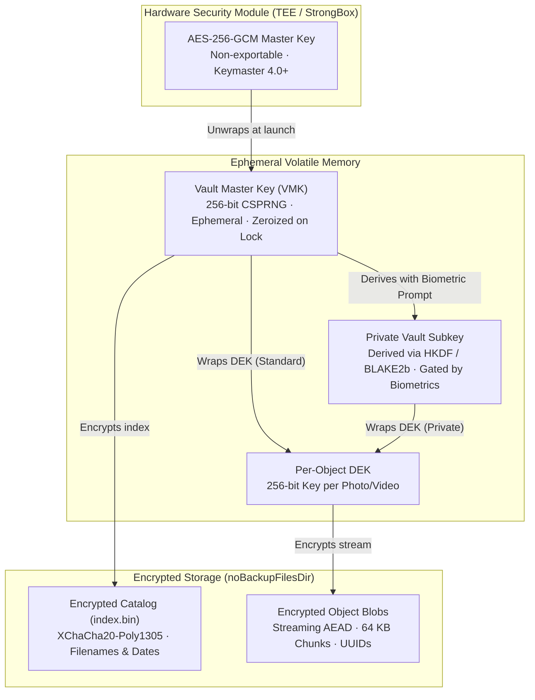

<div align="center">


# ZARC
### The Zero-Knowledge Hardware-Backed Encrypted Photo & Video Vault

**A uncompromising, high-security offline media gallery and disguised container engine for Android.**  
*Native Rust cryptographic core · libsodium streaming AEAD · Android Keystore StrongBox · Hallmark OLED Design*

[](#prerequisites)
[](#native-security-core)
[](#hallmark-design-system)
[](#cryptographic-architecture)
[](#project-zarc--disguised-polyglot-photo-archives-albumjpg)
[-success)](#1-zero-cleartext-at-rest--strict-air-gap)
[](LICENSE)

[Why Zarc Differs](#-why-zarc-is-not-a-normal-gallery) • [Feature Tour](#-features-in-depth) • [Disguised Archives](#-project-zarc--disguised-polyglot-photo-archives-albumjpg) • [Format Support](#-supported-media-formats-honest-breakdown) • [Security Model](#-cryptographic-architecture) • [Building](#-building-and-verification) • [Author](#-developer--credits)

</div>

---

## ⚠️ Why Zarc is NOT a Normal Gallery

> [!IMPORTANT]
> **Zarc is fundamentally not an ordinary photo gallery or camera-roll viewer.**  
> It does not scan your filesystem, it does not index your `DCIM/` folder, and it **never** leaves unencrypted media on flash memory.

Virtually all Play Store "photo vault" or "secret locker" apps rely on **security theater**:
- They rename `.jpg` to `.bin` or place a `.nomedia` file inside a hidden folder.
- They render a password screen, but leave raw image bytes sitting unencrypted on storage.
- Plugging the phone into a PC via USB, pulling files with ADB, or opening a basic file explorer exposes every single image and video in plaintext.

### How Zarc Operates Differently:

1. **Zero Cleartext at Rest (Authenticated Cryptographic Sealing)**:
   - When media is imported into Zarc, it is encrypted using **XChaCha20-Poly1305** authenticated streaming AEAD with a fresh 256-bit per-object Data Encryption Key (DEK).
   - Filenames, capture dates, dimensions, video duration, and thumbnails are sealed inside an encrypted catalog (`index.bin`). The disk contains only random hexadecimal UUID blobs.
2. **Immune to OEM "Cleaners" & Junk Boosters**:
   - Media resides strictly in Android's `Context.noBackupFilesDir`.
   - OEM junk cleaners, storage optimizers, and automated cleanup tools cannot reach, delete, or alter vault media.
   - Automatically excluded from cloud backups and OS-level device transfers to prevent remote exfiltration.
3. **100% Air-Gapped (Zero Network Permissions)**:
   - `AndroidManifest.xml` **omits `android.permission.INTERNET`**.
   - The app possesses zero network sockets or APIs. It is physically incapable of transmitting telemetry, crash logs, or analytics.
4. **Hardware-Backed Keystore Isolation**:
   - Master envelope keys are rooted in Android's **Trusted Execution Environment (TEE)** or **StrongBox** hardware module (`KeyProperties.PURPOSE_ENCRYPT | KeyProperties.PURPOSE_DECRYPT`).
   - Private key material never leaves isolated hardware keystore silicon.
5. **Fail-Closed Cryptographic Invariants**:
   - Any modification, truncation, bit-flip, reordering, or substitution of an encrypted block causes an immediate Poly1305 authentication failure. Nothing is ever loaded on a "best-effort" basis.

---

## 🌟 Features in Depth

### 1. High-Performance Encrypted Roll
- **Engineered for 10,000+ Items**: Paginated memory windowing with LRU thumbnail caching ensures fluid 120Hz rendering across large libraries without OOM risks.
- **Buttery-Smooth Fast Scrollbar**: Custom precision thumb tracker mapped 1:1 to the library timeline, completely eliminating jitter and lag.
- **Dynamic 2–6 Column Grid**: Responsive pinch-to-zoom layout transitions seamlessly between 2 and 6 columns (defaults to a balanced 4-column grid).
- **Chronological Date Groupings**: Sticky date headers and floating timestamp pills keep timelines structured.
- **Batch Multi-Select Mode**: Header-level and item-level selection checkmarks paired with a high-contrast bottom action bar (Favorite, Delete, More).

### 2. Media Viewer & Dual-Pane Split View
- **Gesture Zoom & Video Player**: Pinch-to-zoom (1×–6×), double-tap snap, and integrated hardware-accelerated video playback.
- **Interactive Bottom Filmstrip**: Quick horizontal thumbnail carousel for effortless sequential browsing.
- **Dual-Pane Split Screen**: Compare two photos or videos side-by-side with independent pan, zoom, and thumbnail selectors.
- **Zero-Truncation Details Modal**: Hairline-bordered technical inspector displaying file name, resolution, uncompressed size, capture timestamp, MIME format, and hardware encryption parameters.

### 3. Concealed Biometric & Stealth Private Vault
- **Zero-Trace Entry**: Hidden from all navigation bars, menus, and drawers. Accessible solely via an intentional **long-press on the top-left header** (`Roll` / `Photos` / `Videos`).
- **Hardware Biometric Gate**: Gated behind Android `BiometricPrompt` (Fingerprint, Face, Hardware Lockscreen Credential).
- **Dynamic Time-Based Stealth PIN**: Optional secondary gate requiring a dynamic mathematical time PIN:
  $$\text{PIN} = \text{Current Minute } (MM) + \text{Reversed 24h Hour } (\text{rev}(HH))$$
  *(For example: at 13:17, Minute is `17`, Hour is `13` $\rightarrow$ reversed `31`, producing PIN `1731`)*.
- **Write Without Pre-Unlock**: Move media into the Private Vault directly from any selection without requiring authentication upfront.
- **Auto-Locking Lifecycle**: Navigating away from the private screen immediately zeros the private subkey in memory, purging temporary caches and decrypted bitmaps.
- **Dedicated Private Recycle Bin**: Independent encrypted retention bin with 30-day auto-purge countdowns.

### 4. 30-Day Auto-Purge Recycle Bin
- **Retention Countdown Badges**: Soft-deleted files show remaining retention days (`29d left`, `today`, etc.).
- **Automatic Permanent Shredding**: Media older than 30 days is automatically purged and overwritten on disk.
- **Interactive Bin Viewer**: Preview deleted media full-screen, restore with a tap, or destroy permanently with confirmation dialogs.

### 5. Hallmark Design System & Offline Typography
- **Hallmark Floor Discipline**: Free of AI templates, purple-to-blue gradients, cards-in-cards, and emojis as UI icons.
- **OLED Midnight Surface Ladder**: 4-tier dark surface foundation (`0xFF07080A` to `0xFF262B3A`) paired with a restrained cobalt accent (`0xFF4CA5FF`).
- **Concentric Radii & Tactile Hairlines**: 1dp `outlineVariant` borders establish clean elevation boundaries.
- **Offline Andika Typography**: Bundled Google Fonts Andika typography rendered completely offline.
- **Haptic Feedback**: Subtle vibration cues for navigation, selection toggles, long presses, and viewer gestures.

---

## 🗃️ PROJECT ZARC — Disguised Polyglot Photo Archives (`Album.jpg`)

Zarc features a dedicated custom archive system that disguises encrypted photo collections as genuine JPEG photos:

```text
DISGUISED ZARC CONTAINER (Album.jpg)
┌────────────────────────────────────────────────────────────┐
│ 1. Genuine Metadata-Sanitised JPEG Cover Photo             │
│    SOI (0xFF, 0xD8) ─── Compressed Scan Data ─── (0xFF, 0xD9)│
├────────────────────────────────────────────────────────────┤
│ 2. Appended Custom ZARC Binary Container Payload          │
│    • Fixed Public Header (Magic: 'ZARC', Version, Flags)   │
│    • Random Container ID & Argon2id Salt                   │
│    • Key-Wrapping Nonce & Encrypted Content DEK            │
│    • Encrypted Content Objects (Sanitised Photos 1..N)     │
│    • Encrypted Manifest (Filenames, Dimensions, MediaTypes)│
├────────────────────────────────────────────────────────────┤
│ 3. 32-Byte Fixed-Length Trailer & Locator (O(1) Seek)      │
│    [Payload Offset (u64)] [Payload Len (u64)]              │
│    [Header Len (u32)] [Version (u16)] [Flags (u16)]        │
│    [Magic: 'ZARC' (4 bytes)]                               │
└────────────────────────────────────────────────────────────┘
```

### Key Technical Properties:
1. **Outer Disguise Compatibility**:
   - The file begins with a valid JPEG header (`0xFF, 0xD8`) and ends its image stream with standard JPEG EOI (`0xFF, 0xD9`).
   - Stock Android gallery apps, Google Photos, WhatsApp file senders, and desktop image viewers open and display the cover photo normally.
2. **Metadata Sanitization in Rust**:
   - Prior to packaging, all images (JPEG, PNG, WebP) are stripped of EXIF, GPS location, camera serial numbers, IPTC, and XMP metadata at the byte level in native Rust without generational loss.
3. **Argon2id + XChaCha20-Poly1305 Security**:
   - Encryption keys are derived using **Argon2id** (memory-hard, GPU/ASIC-resistant).
   - Filenames, dimensions, media types, and photo payloads remain 100% ciphertext until unlocked with the correct passphrase.
4. **Deterministic $O(1)$ Locator**:
   - The extractor seeks directly to the last 32 bytes of the file, verifies the trailer magic, and jumps directly to the encrypted payload without fragile or slow byte-scanning.
5. **In-App Inspection & Extraction**:
   - Opening `Album.jpg` immediately displays the outer cover with zero password required.
   - Supplying the passphrase authenticates the container and unlocks an interactive browser allowing single-photo inspection or bulk extraction to user-selected device folders via the Storage Access Framework (SAF).

---

## 🔍 Supported Media Formats (Honest Breakdown)

Zarc does not claim to support "literally all" media formats. It is specifically built for common mobile photos and videos:

| Context | Supported Formats | Unsupported / Intentionally Omitted |
| :--- | :--- | :--- |
| **Main Vault Photos** | **JPEG** (`.jpg`, `.jpeg`), **PNG** (`.png`), **WebP** (`.webp`), **HEIC** (`.heic`), **GIF** (`.gif`, first frame), **BMP** | Camera RAW (`.dng`, `.cr2`, `.nef`, `.arw`), TIFF, SVG vectors, PSD, AVIF (< API 31) |
| **Main Vault Videos** | **MP4** (`.mp4`), **MKV** (`.mkv`), **MOV** (`.mov`), **WebM** (`.webm`), **3GP** (`.3gp`) | AVI, WMV, FLV, TS, ProRes, or codecs without hardware decoders on the device |
| **Disguised Archive Cover** | **JPEG only** (`0xFFD8` ... `0xFFD9`) | PNG, WebP, GIF, HEIC cannot serve as the outer disguise carrier |
| **Disguised Archive Content** | **JPEG**, **PNG**, **WebP** | Formats without byte-level metadata parsers are rejected to prevent location/privacy leaks |

---

## 🔒 Cryptographic Architecture



### Cryptographic Parameters

| Dimension | Specification |
| :--- | :--- |
| **Symmetric Cipher** | `crypto_secretstream_xchacha20poly1305` (IETF draft, 192-bit nonce, 256-bit key) |
| **Chunking & Streaming** | 64 KiB chunks with incremental Poly1305 MAC tags (`TAG_MESSAGE` / `TAG_FINAL`) |
| **Key Wrapping** | `crypto_aead_xchacha20poly1305_ietf` with authenticated contextual AAD |
| **Archive KDF** | **Argon2id** (`m_cost`: 64 MiB, `t_cost`: 3 passes, `p_cost`: 4 lanes) |
| **Subkey Derivation** | BLAKE2b-based subkey derivation (`zarc.private.v1`) |
| **Memory Sanitization** | Automatic memory zeroization via Rust `zeroize` crate and JVM explicit sweeps |

---

## 🏗️ Repository Architecture

```text
zarc/
├── android/                         # Android Studio Gradle Project
│   ├── app/src/main/
│   │   ├── AndroidManifest.xml      # Zero-permission air-gapped manifest
│   │   ├── res/font/                # Offline Andika typography
│   │   └── java/com/zarc/vault/
│   │       ├── archive/             # Disguised .jpg & .zarc repository & extraction
│   │       ├── core/                # JNI bindings, native bridge, vault repository
│   │       ├── gallery/             # Gallery state, index serialization, private gate
│   │       ├── keystore/            # StrongBox / TEE key manager
│   │       └── ui/                  # Compose UI (Screens, Viewer, Info, Theme, Haptics)
├── crates/
│   ├── zarc-core/                   # Pure Rust cryptographic engine
│   │   ├── src/archive/             # Custom container format, Argon2id & metadata sanitizer
│   │   ├── src/container.rs         # 152-byte header parser and validator
│   │   ├── src/vault.rs             # Atomic, fsync write pipeline
│   │   ├── src/keywrap.rs           # VMK / DEK key wrapping
│   │   └── src/sodium/              # Vendored libsodium FFI bindings
│   └── zarc-jni/                    # JNI bridge exposing C-ABI to Kotlin
├── third_party/libsodium/           # Vendored libsodium 1.0.22 with SHA-256 verification
├── tools/                           # PowerShell build & deployment automation scripts
└── docs/                            # FORMAT_SPEC.md & technical security documentation
```

---

## 🛠️ Building and Verification

### Prerequisites
- **Android SDK**: API 36 Platform (minimum SDK 24)
- **Android NDK**: Version 27.1+ (`android-ndk-r27c` recommended)
- **Rust**: 1.85+ stable with target toolchains:
  ```bash
  rustup target add aarch64-linux-android armv7-linux-androideabi i686-linux-android x86_64-linux-android
  ```
- **JDK**: OpenJDK 21
- **Gradle**: 9.6.1 (wrapper included)

### Build Commands

```powershell
# 1. Compile native Rust cryptographic libraries for all Android ABIs
powershell -NoProfile -ExecutionPolicy Bypass -File tools\build-android.ps1

# 2. Compile and package the debug APK
cd android
.\gradlew assembleDebug

# 3. Install to connected device or emulator
adb install -r app\build\outputs\apk\debug\app-debug.apk
```

### Running Native & Integration Tests

```bash
# Execute Rust unit, property, and format roundtrip tests
cargo test --workspace

# Execute custom archive format and metadata sanitization tests
cargo test -p zarc-core --test archive_test
```

---

## 👨‍💻 Developer & Credits

- **Developer**: Meet Mistry
- **Email**: [meetzarc@gmail.com](mailto:meetzarc@gmail.com)
- **Portfolio / Website**: [https://meetmistry.vercel.app](https://meetmistry.vercel.app)
- **GitHub**: [@MZarc](https://github.com/MZarc)

---

## 📄 License

This project is licensed under the **Apache License 2.0** — see the [LICENSE](LICENSE) file for details.  
Vendored **libsodium** is distributed under the ISC License.
