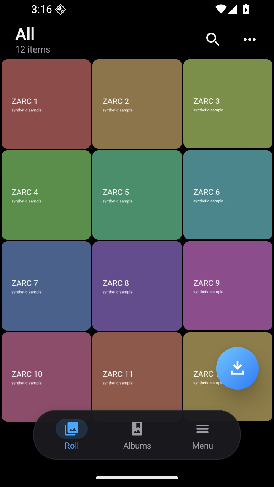
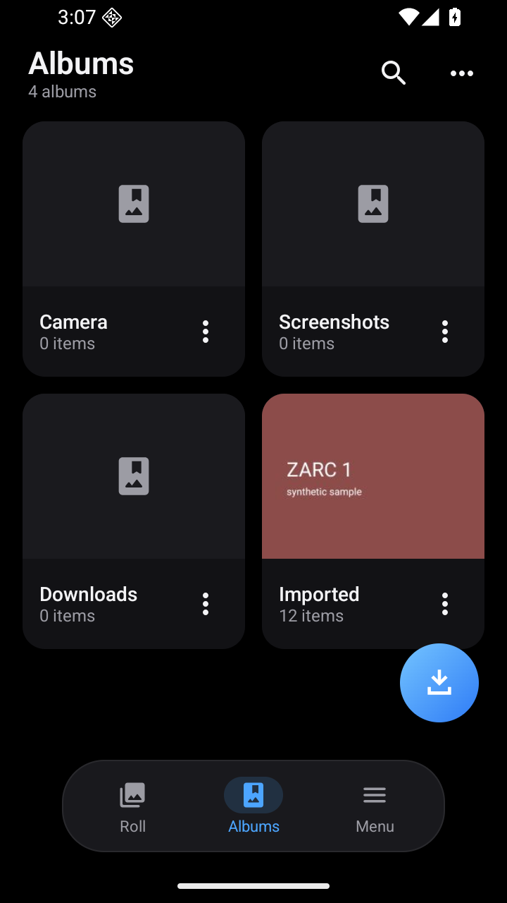
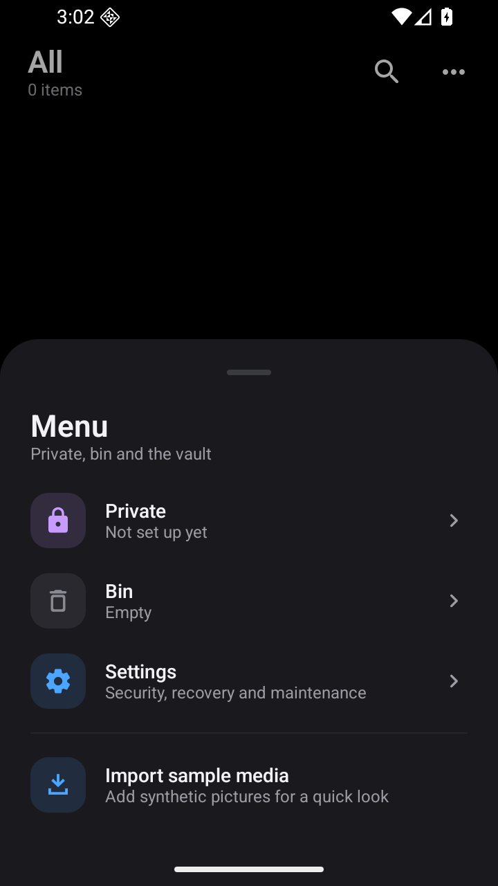
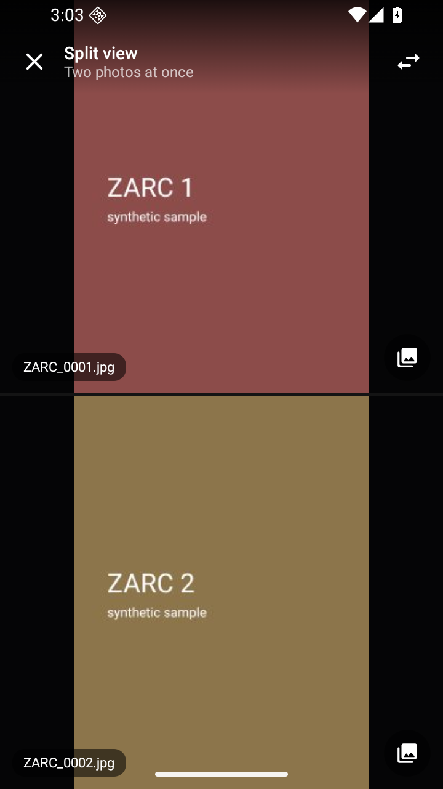

<div align="center">

# Zarc

### The private gallery vault for Android

**A dark, One UI inspired gallery whose media never exists in the clear.**
Rust encryption core · libsodium · Android Keystore · Jetpack Compose

[](#requirements)
[](#architecture)
[](#the-gallery)
[](#cryptography)
[](LICENSE)
[](#project-status)

[Features](#the-gallery) · [Security](#security-model) · [Architecture](#architecture) · [Build](#build-from-source) · [Verify](#verification) · [Docs](#documentation)

</div>

---

> **Project status: experimental prototype.** The test suite is complete and
> passing on an emulator and a physical device, but Zarc has **not** been
> independently audited, certified or formally verified. Do not trust it with
> data you cannot afford to lose. The exact evidence — and the exact gaps —
> are in [`docs/VALIDATION_REPORT.md`](docs/VALIDATION_REPORT.md).

## Why Zarc

Most "private gallery" apps hide files behind a PIN and call it encryption.
Zarc encrypts each item into an opaque, authenticated container, keeps the
keys in the Android Keystore, and builds the gallery on top of that engine —
not the other way around.

- The vault stores **ciphertext only**. Names, albums, thumbnails and the index
  are sealed with the vault key; the vault directory contains nothing
  descriptive.
- The gallery needs **no storage permission**. Import goes through the Storage
  Access Framework.
- Every object is authenticated. A modified, truncated, reordered, duplicated
  or substituted file is rejected and **nothing is published**.
- Failure is closed: a missing key, a wrong key or a damaged header is an
  error, never a best-effort decode.

## The gallery

<div align="center">

| Roll | Albums | Menu | Split view |
|:---:|:---:|:---:|:---:|
|  |  |  |  |

<sub>Screens shown with synthetic sample media.</sub>

</div>

A dark, One UI inspired interface with a floating pill navigation bar and
sheet-based actions:

| Area | What it does |
|------|--------------|
| **Roll** | Three-column grid of photos and videos, title and item count under the status bar, search, sort, `All / Photos / Videos` filter, long-press selection, select all, move, delete |
| **Albums** | Covers, counts, create, rename, delete; `Camera`, `Screenshots`, `Downloads` and `Imported` exist from the start |
| **Private** | Unlocked with device authentication (biometric or device credential); its media is encrypted with a **separate subkey**, so it is protected twice |
| **Bin** | Deleting moves the encrypted object; restoring moves it back; emptying removes it permanently |
| **Settings** | Real Keystore protection report, recovery state, key rotation, private area, developer tools |
| **Viewer** | Full-screen with pinch zoom, capture date, open-with, re-encrypt and delete; **split view** for two photos at once (stacked in portrait, side by side in landscape) |
| **Import / share** | SAF import with no storage permission; open-with decrypts into the cache and hands it over through a `FileProvider` with a temporary grant — the vault object itself is never shared |

There is no third-party Android UI dependency: the icons are the Material
Rounded family plus a hand-drawn import vector (`ZarcIcons.kt`).

## Security model

```text
        Android Keystore                     Vault master key (VMK)
  ┌────────────────────────┐            ┌──────────────────────────┐
  │ AES-256-GCM,           │  wraps     │ 256-bit, generated on    │
  │ non-exportable,        │ ─────────► │ device, memory only,     │
  │ hardware when possible │            │ wrapped at rest          │
  └────────────────────────┘            └────────────┬─────────────┘
                                                     │ wraps
                                          ┌──────────▼─────────────┐
                                          │ Per-object data key    │
                                          │ 256-bit, one per file  │
                                          └──────────┬─────────────┘
                                                     │ encrypts
                                          ┌──────────▼─────────────┐
                                          │ XChaCha20-Poly1305     │
                                          │ secretstream container │
                                          └────────────────────────┘
```

| Property | How it is established |
|----------|-----------------------|
| **Confidentiality at rest** | `crypto_secretstream_xchacha20poly1305` over the content; per-object DEK wrapped with `crypto_aead_xchacha20poly1305_ietf` under the VMK |
| **Integrity and authenticity** | Per-chunk Poly1305 tags, `TAG_FINAL`, authenticated header fields and a bound object id; any tampering fails the operation |
| **Key protection** | Non-exportable AES-256-GCM Keystore key; the platform's real protection level is reported, never guessed |
| **Device loss recovery** | Optional passphrase envelope: Argon2id + XChaCha20-Poly1305 protects a second copy of the VMK; the passphrase is never stored |
| **Key rotation** | Rotate the VMK without re-encrypting content; re-encrypt a single object with a fresh DEK |
| **No plaintext leaks** | Verified by an on-device storage audit with elevated privileges (the vault itself is clean; known working copies are reported explicitly) |
| **Transactional writes** | Temporary file, fsync, atomic rename; a crash leaves either the old state or the new one, never a partial object |
| **No logging of secrets** | The Rust core contains no logging at all; a source-level test enforces it |

The content format is a versioned 152-byte header followed by the
secretstream ciphertext. The object id is random; the file name is its hex
encoding. A parser rejects mismatched lengths, unknown versions, trailing
data and non-zero reserved fields — there is no "best effort" path. See
[`docs/FILE_FORMAT.md`](docs/FILE_FORMAT.md).

### Cryptography

- Content: libsodium `crypto_secretstream_xchacha20poly1305` (streaming AEAD,
  bounded memory, per-chunk authentication, authenticated final tag).
- Key envelope: libsodium `crypto_aead_xchacha20poly1305_ietf`.
- Keystore: AES-256-GCM, non-exportable, StrongBox when the platform accepts it.
- Recovery: Argon2id + XChaCha20-Poly1305-IETF.
- Randomness: libsodium / platform CSPRNG only.
- libsodium 1.0.22 is **vendored** and its minisign signature is verified on
  every build; a verification failure is a hard build error.

Rationale, rejected alternatives and version pinning:
[`docs/CRYPTOGRAPHY_DECISION.md`](docs/CRYPTOGRAPHY_DECISION.md).

## Architecture

```text
┌───────────────────────────────────────────────────────────────────┐
│ Kotlin · Jetpack Compose                                          │
│   GalleryActivity / GalleryScreens / ViewerAndSettings            │
│   GalleryViewModel        state, sort, filter, selection, split   │
│   VaultRepository         paths, VMK lifecycle, media index       │
│   KeystoreKeyManager      AES-256-GCM key, StrongBox, key report  │
└──────────────────────────────┬────────────────────────────────────┘
                               │ JNI: file paths and the VMK only
┌──────────────────────────────▼────────────────────────────────────┐
│ Rust · crates/zarc-core                                           │
│   container   versioned, opaque object format                     │
│   keywrap     VMK → DEK hierarchy                                 │
│   vault       transactional, fail-closed encrypt / decrypt        │
│   sodium      the only module with unsafe: a narrow libsodium FFI │
└──────────────────────────────┬────────────────────────────────────┘
                               │
┌──────────────────────────────▼────────────────────────────────────┐
│ libsodium 1.0.22 (vendored, signature verified at build time)     │
│   secretstream XChaCha20-Poly1305 · AEAD XChaCha20-Poly1305-IETF  │
└───────────────────────────────────────────────────────────────────┘
```

**Repository layout**

```text
crates/zarc-core/       Rust crypto, container format, key hierarchy, vault
crates/zarc-jni/         JNI bridge to the Android application
android/                 Gradle project: Compose UI + instrumented tests
fuzz/                    cargo-fuzz targets for parser, stream and envelope
third_party/libsodium/   vendored, signed upstream release
tools/                   build, verify, watch, audit and device-audit scripts
docs/                    threat model, crypto decisions, ADRs, validation
```

## Requirements

| Tool | Version |
|------|---------|
| Rust | 1.93.1 (pinned in `rust-toolchain.toml`) |
| Android SDK | platform 36 |
| Android NDK | 27.1 |
| JDK | 21 |
| Gradle | 9.6.1 (wrapper included) |
| Python | 3, for the audit scripts |

Rust Android targets:

```powershell
rustup target add --toolchain 1.93.1-x86_64-pc-windows-msvc `
  aarch64-linux-android armv7-linux-androideabi i686-linux-android x86_64-linux-android
```

`ANDROID_HOME` (or `ANDROID_SDK_ROOT`) must point at the SDK.

## Build from source

```powershell
# 1. Build the native library for four ABIs and stage it for Gradle
powershell -NoProfile -ExecutionPolicy Bypass -File tools\build-android.ps1

# 2. Debug APK (application id com.zarc.vault.debug)
cd android
.\gradlew.bat assembleDebug
# -> android\app\build\outputs\apk\debug\app-debug.apk

# 3. Install and launch
adb install -r app\build\outputs\apk\debug\app-debug.apk
```

Release builds are minified with R8 and **must be signed**. The signing key
never lives in the source tree: provide `android/keystore.properties` (git
ignored) or the environment variables:

```properties
ZARC_KEYSTORE=zarc-release.jks
ZARC_KEYSTORE_PASSWORD=...
ZARC_KEY_ALIAS=zarc
ZARC_KEY_PASSWORD=...
```

```powershell
.\gradlew.bat assembleRelease
# -> app\build\outputs\apk\release\app-release.apk
#    app\build\outputs\mapping\release\mapping.txt
```

Without a configured key the release build fails explicitly instead of
producing an unsigned artifact.

### The edit → screen loop

Android cannot hot-load Kotlin from a terminal, so this repository ships a
watcher that rebuilds incrementally, installs and relaunches:

```powershell
# once, to warm the daemon and the configuration cache
cd android; .\gradlew.bat :app:assembleDebug

# leave running in another terminal
powershell -NoProfile -ExecutionPolicy Bypass -File tools\watch-ui.ps1
```

Measured on the development machine (warm daemon, configuration cache on):
about **32 s** for an edited Compose file to a new APK, and **8 s** to
install, launch and reload. The debug build also has a `ReloadReceiver` for
the `com.zarc.vault.action.RELOAD` broadcast.

## Verification

```powershell
# Rust: format, strict lint, unit and integration tests
cargo fmt --all -- --check
cargo clippy --workspace --all-targets -- -D warnings
cargo test --workspace                  # 102 tests

# Dependency and license audit (OSV + accepted licenses)
python tools\audit-deps.py

# Instrumented tests on a connected device or emulator
cd android
.\gradlew.bat connectedDebugAndroidTest

# Storage leakage audit with elevated privileges
cd ..
powershell -NoProfile -ExecutionPolicy Bypass -File tools\device-audit.ps1

# Everything, with a PASS/FAIL summary
powershell -NoProfile -ExecutionPolicy Bypass -File tools\verify.ps1
```

Fuzzing (nightly + `cargo-fuzz`):

```powershell
rustup toolchain install nightly --profile minimal
cargo +nightly install cargo-fuzz --locked
cd fuzz
# On Windows, make the MSVC AddressSanitizer runtime reachable:
$env:PATH = "C:\Program Files (x86)\Microsoft Visual Studio\18\BuildTools\VC\Tools\MSVC\14.50.35717\bin\HostX64\x64;" + $env:PATH
cargo +nightly fuzz run parse_container -- -max_total_time=120
cargo +nightly fuzz run decrypt_stream  -- -max_total_time=120
cargo +nightly fuzz run wrap_key        -- -max_total_time=120
```

### What was actually verified

| | Emulator (API 36) | Samsung Galaxy A54 (Android 16) |
|---|---|---|
| Rust suite (102 tests), strict Clippy | PASS | — |
| Fuzzing, 3 targets (4.4 M executions) | PASS | — |
| Property-based and interop tests | PASS | — |
| Instrumented suite (debug) | PASS | PASS |
| Instrumented suite (R8 release) | n/a | PASS |
| Keystore protection level, as reported | `SOFTWARE` | **`TRUSTED_ENVIRONMENT`, hardware backed** |
| StrongBox | not present | not present |
| Storage leakage audit | with root | app's own privileges |

Not established: StrongBox, low-storage behaviour, libsodium's own test suite,
an independent security review. See
[`docs/VALIDATION_REPORT.md`](docs/VALIDATION_REPORT.md).

## Security notes and limitations

Zarc is honest about what it does not protect. The full list is in
[`SECURITY.md`](SECURITY.md); the essentials:

1. **The plaintext length is stored in the clear**, as are object count,
   sizes and access patterns. The existence of encrypted data is visible.
2. **A factory reset, a wiped Keystore or a new device destroys the
   device-bound VMK.** Without a recovery passphrase the vault is
   unrecoverable; with one, Argon2id + XChaCha20-Poly1305 restores it.
3. **The VMK is in process memory while an operation runs.** Zeroization
   narrows the window; it does not eliminate it.
4. **A compromised OS, root, or malware inside the app is out of scope.**
5. **Deleting a file does not guarantee forensic erasure on flash storage.**
6. **No independent audit, no StrongBox test, no server-side recovery share.**

## Documentation

| Document | Contents |
|----------|----------|
| [`docs/THREAT_MODEL.md`](docs/THREAT_MODEL.md) | assets, attackers, objectives, exclusions, residual risks |
| [`docs/CRYPTOGRAPHY_DECISION.md`](docs/CRYPTOGRAPHY_DECISION.md) | primitives, evaluated bindings, rejected alternatives |
| [`docs/KEY_MANAGEMENT.md`](docs/KEY_MANAGEMENT.md) | key hierarchy, lifecycle, loss behaviour |
| [`docs/FILE_FORMAT.md`](docs/FILE_FORMAT.md) | byte-level container format and metadata leakage |
| [`docs/TEST_PLAN.md`](docs/TEST_PLAN.md) | every test case, expected outcome and command |
| [`docs/VALIDATION_REPORT.md`](docs/VALIDATION_REPORT.md) | actual results, with limitations |
| [`docs/adr/`](docs/adr/) | architecture decision records (ADR-0001 → ADR-0005) |
| [`SECURITY.md`](SECURITY.md) | reporting process and known limitations |

## License

Project code: **Apache-2.0** — see [`LICENSE`](LICENSE).
The vendored libsodium release is **ISC** licensed; its license text ships
inside the vendored archive.
