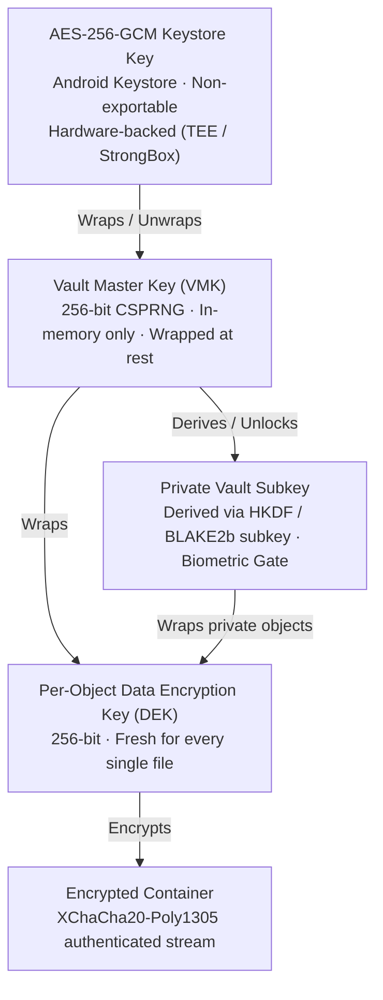

<div align="center">

# Zarc

### The Zero-Knowledge Encrypted Media Vault for Android

**An uncompromising, high-security encrypted vault engineered with a dark, One UI inspired aesthetic.**  
*Native Rust cryptographic core · libsodium authenticated streaming AEAD · Android Keystore Hardware Backed · Jetpack Compose*

[](#requirements)
[](#architecture)
[](#the-experience)
[](#cryptography)
[](#project-status)
[](LICENSE)

[Why It Is Not a Normal Gallery](#this-is-not-a-normal-gallery) · [Security & Architecture](#security-model) · [Key Features](#features-at-a-glance) · [Build & Verify](#build-from-source) · [Developer](#developer--credits)

</div>

---

## ⚠️ THIS IS NOT A NORMAL PHONE GALLERY

> [!IMPORTANT]  
> **Zarc is NOT an ordinary photo viewer or stock Android camera roll app.**  
> It does not scan your filesystem, it does not index your DCIM folder, and it never leaves your precious media sitting unencrypted on your disk.

Ordinary phone galleries and so-called "vault" or "secret locker" apps usually just hide plaintext files behind a PIN lock, rename file extensions (e.g. from `.jpg` to `.bin`), or hide folders inside `.nomedia` directories. If the device is connected to a computer via USB, backed up via ADB, or scanned with a file manager, all files remain completely visible as unencrypted plaintext.

### How Zarc Differs Radically:

1. **Zero Cleartext at Rest (Cryptographic Sealing)**:
   - When media is imported into Zarc, it is transformed into an authenticated, opaque binary container encrypted with **XChaCha20-Poly1305** using a unique per-object Data Encryption Key (DEK).
   - Filenames, capture dates, dimensions, video duration, thumbnails, and directory structures are completely sealed inside an encrypted catalog (`index.bin`). The storage directory contains only random hexadecimal UUID hashes.
2. **Protected from System & Cleaner Utilities**:
   - Vault files are stored strictly in Android's `Context.noBackupFilesDir`.
   - Aggressive OEM cache cleaners, "storage boosters", and junk cleanup tools cannot delete, clear, or touch your vault media.
   - Automatically excluded from cloud backups and OS-level device syncs to prevent remote leakage.
3. **100% Offline with Zero Network Permissions**:
   - `AndroidManifest.xml` declares **NO `android.permission.INTERNET`**.
   - The application has zero capability to transmit analytics, telemetry, crash dumps, or vault blobs over the network. It is entirely air-gapped.
4. **Hardware-Backed Keystore Isolation**:
   - Keys are rooted in Android's Trusted Execution Environment (TEE) / StrongBox keystore (`KeyProperties.PURPOSE_ENCRYPT | KeyProperties.PURPOSE_DECRYPT`).
   - Private key material never leaves isolated hardware keystore modules.
5. **Fail-Closed Cryptographic Invariants**:
   - Any modification, truncation, bit-flip, reordering, or substitution of an encrypted block causes an immediate Poly1305 authentication failure. Nothing is ever decoded on a "best-effort" basis.

---

## Features at a Glance

### 1. High-Performance Encrypted Roll
- **Optimized for 10,000+ Items**: Paginated memory windowing and cached sealed thumbnails ensure fluid, buttery-smooth 120Hz scrolling even across massive photo archives.
- **Dynamic 2–6 Column Grid**: Pinch-to-zoom in and out of the grid smoothly, or pick your layout directly. Defaults to a clean 4-column layout.
- **Date Separation & Sticky Overlay**: Clear chronological date separation headers with a hovering date pill during fast scroll.
- **Fast Scrollbar**: Precision thumb tracking mapped 1:1 to library timeline without jitter or jumpiness.
- **Batch Multi-Select Mode**: Intuitive round checkmarks on headers, date groupings, and individual items. Multi-select bottom action bar with high-contrast accessibility (Favorite, Delete, and More sheet).

### 2. Deep Media Viewer & Independent Split View
- **Gesture Zoom & Video Player**: Pinch-to-zoom (1×–6×), double-tap snap, and integrated `androidx.media3` video player.
- **Filmstrip Mini-Roll**: Interactive horizontal filmstrip tile bar at the bottom for quick thumbnail browsing.
- **Dual-Pane Split Viewer**: Compare two photos or videos simultaneously with independent mini-rolls and full zoom/pan capabilities on both panes.
- **Full Metadata & Info Modal**: Clean inspection dialog displaying file name, resolution, uncompressed size, capture timestamp, MIME format, and hardware encryption parameters with zero awkward text truncation.

### 3. Hidden Biometric & Stealth Private Vault
- **Zero Evidence Private Area**: Hidden from top bars, menus, and settings. Accessed exclusively via an intentional **long-press on the top-left header** (`Roll` / `Photos` / `Videos`).
- **Hardware Biometric Lock**: Protected behind Android BiometricPrompt (Fingerprint / Face / Hardware Credential).
- **Time-Based Stealth PIN Protection**: Optional double-protection layer requiring a dynamic reversed time PIN (e.g., at `14:05`, the stealth PIN is `0541`).
- **Write Without Pre-Unlock**: Move items into the Private Vault seamlessly from anywhere without unlocking first.
- **Auto-Locking Lifecycle**: Leaving the private view immediately zeros the private subkey in memory, purging temporary caches and decrypted memory bitmaps.
- **Isolated Private Recycle Bin**: Dedicated encrypted trash bin for private media with independent 30-day auto-purge countdowns.

### 4. Real 30-Day Auto-Purge Recycle Bin
- **True Expiration Countdown**: Soft-deleted files display remaining days left (`29d left`, `today`, etc.).
- **Automatic Purge**: Upon entering the bin, items older than 30 days are permanently shredded from disk.
- **Interactive Bin Viewer**: Preview deleted media full-screen, restore with a tap, or permanently destroy with explicit confirmation modals.

### 5. Custom Typography & Haptics
- **Andika Typography**: Clean, legible, and elegant Google Fonts Andika typography bundled 100% offline.
- **Tactile Vibration Haptics**: Subtle physical vibration responses across navigation taps, long presses, multi-select toggles, and viewer swipe actions.

---

## Security Model



| Security Dimension | Technical Implementation |
|---|---|
| **Cipher at Rest** | `crypto_secretstream_xchacha20poly1305` (Streaming AEAD, bounded 64 KB memory chunks) |
| **Integrity & Authenticity** | Per-chunk Poly1305 MAC tags with authenticated `TAG_FINAL` headers |
| **Key Hierarchy** | Rooted in Android Keystore AES-256-GCM. VMK unwrapped only into ephemeral memory |
| **Private Vault Isolation** | Authenticated subkey derivation (`zarc.private.v1`) wrapped with Keystore biometric auth |
| **Disaster Recovery** | Optional Argon2id + XChaCha20-Poly1305 passphrase envelope for recovery across devices |
| **Key Zeroization** | Rust `Zeroize` and JVM explicit memory wipes upon lock or backgrounding |
| **Network Exposure** | Absolutely zero network access (`INTERNET` permission omitted) |

---

## Architecture & Codebase Structure

```
zarc/
├── android/                         # Android Studio Gradle Project
│   ├── app/src/main/
│   │   ├── AndroidManifest.xml      # Zero-permission security manifest
│   │   ├── res/font/                # Offline Andika typography fonts
│   │   └── java/com/zarc/vault/
│   │       ├── core/                # JNI bindings, native wrapper, vault repository
│   │       ├── gallery/             # Gallery repository, index serialization, private gate
│   │       ├── keystore/            # Hardware Keystore key manager & TEE reporting
│   │       └── ui/                  # Jetpack Compose UI (Screens, Viewer, Info, Theme, Haptics)
├── crates/
│   ├── zarc-core/                   # High-performance Rust cryptographic engine
│   │   ├── src/container.rs         # Versioned 152-byte opaque header parser & validator
│   │   ├── src/vault.rs             # Transactional, atomic, fsync write pipeline
│   │   ├── src/keywrap.rs           # VMK / DEK hierarchical key wrapping
│   │   └── src/sodium/              # Vendored libsodium FFI bridge
│   └── zarc-jni/                    # Rust JNI bindings for Android
├── third_party/libsodium/           # Vendored libsodium 1.0.22 with cryptographic signature check
├── tools/                           # Automated build, verification, and device audit scripts
└── docs/                            # In-depth security specifications & architectural ADRs
```

---

## Requirements & Building from Source

### Prerequisites
- **Android SDK**: API Platform 36 (minSdk 24)
- **Android NDK**: Version 27.1+
- **Rust**: 1.93.1 (`rustup target add aarch64-linux-android armv7-linux-androideabi i686-linux-android x86_64-linux-android`)
- **JDK**: OpenJDK 21
- **Gradle**: 9.6.1 (wrapper included)

### Build Commands

```powershell
# 1. Compile the native Rust core for all ABIs (arm64-v8a, armeabi-v7a, x86, x86_64)
powershell -NoProfile -ExecutionPolicy Bypass -File tools\build-android.ps1

# 2. Compile and package the debug APK
cd android
.\gradlew assembleDebug

# 3. Install to connected device or emulator
adb install -r app\build\outputs\apk\debug\app-debug.apk
```

---

## Developer & Credits

- **Developer**: Meet Mistry
- **Email**: [meetzarc@gmail.com](mailto:meetzarc@gmail.com)
- **Website**: [https://meetmistry.vercel.app](https://meetmistry.vercel.app)
- **GitHub**: [github.com/MZarc](https://github.com/MZarc)

---

## License

This project is licensed under the **Apache License 2.0** — see the [LICENSE](LICENSE) file for details.  
Vendored **libsodium** is subject to the ISC license.
